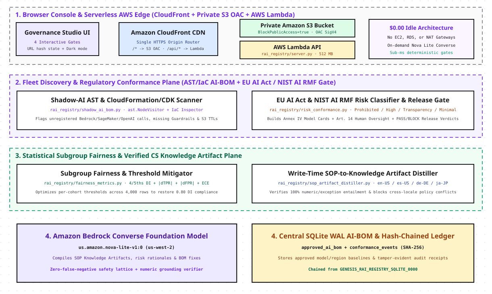

# ResponsibleAIRegistry: Fleet AI Discovery, Regulatory Risk Gate, Fairness Auditing & Verified Policy Artifacts

- **Live CloudFront Application**: https://d26dk62sabtevx.cloudfront.net
- **Live `/api/health` Endpoint**: https://d26dk62sabtevx.cloudfront.net/api/health
- **GitHub Repository**: https://github.com/ritwikareddykancharla/rai-conformance-hub

ResponsibleAIRegistry is a Python 3.12 AI governance, statistical fairness, and Customer Service policy distillation platform deployed on **Amazon CloudFront + Private S3 (OAC) + AWS Lambda (`python3.12`) + SQLite WAL + Amazon Bedrock (`us.amazon.nova-lite-v1:0`)**.



## 01 · Problem

Enterprise AI governance and global Customer Service content platforms face four concrete engineering gaps when teams rely on manual spreadsheets and raw prose prompts:

1. **Unregistered Shadow AI & Configuration Drift**: Application teams add `bedrock-runtime`, `sagemaker-runtime`, or external `openai` and `anthropic` SDK calls directly inside service repositories, or redeploy registered bots to new regions without `AWS::Bedrock::Guardrail` resources and S3 retention limits.
2. **EU AI Act & NIST AI RMF Release Exposure**: High-risk Annex III workloads (candidate resume screening, credit underwriting, telehealth triage, critical infrastructure, biometrics) require structured Model Cards, human-in-the-loop override controls, and deterministic CI/CD release gates.
3. **Subgroup Disparate Impact Under Uniform Cutoffs**: Applying a uniform `0.50` classification threshold across uncalibrated subgroup score distributions causes Four-Fifths (`0.80`) disparate impact violations (`0.5523` baseline DI) and wide true-positive rate gaps (`0.3188` `|ΔTPR|`).
4. **Multi-Locale Customer Service Policy Contradictions**: Feeding multi-page Customer Service SOP prose directly into prompts wastes tokens and fails to catch stale regional translations (`es-US` `45`-day vs `en-US` `30`-day US return windows) or statutory violations (`de-DE` `7`-day vs mandatory `14`-day EU withdrawal minimum).

## 02 · Architecture & Implementation

- `rai_registry/shadow_ai_bom.py`: Parses Python source trees via `ast.NodeVisitor` and inspects CloudFormation/CDK templates (`AWS::Bedrock::Guardrail`, `AWS::SageMaker::Endpoint`, S3 `ExpirationInDays`, DynamoDB TTL, wildcard IAM policies), reconciling every workload against the central SQLite WAL `approved_ai_bom` catalog.
- `rai_registry/risk_conformance.py`: Combines sub-millisecond policy-as-code rules with calibrated Amazon Bedrock (`us.amazon.nova-lite-v1:0`) risk analysis through a max-severity safety lattice across `PROHIBITED`, `HIGH_RISK`, `TRANSPARENCY_LIMITED`, and `MINIMAL_RISK`, generating Model Cards and `PASS_RELEASE` / `BLOCK_MISSING_CONTROLS` verdicts.
- `rai_registry/fairness_metrics.py`: Computes subgroup confusion matrices, Demographic Parity, Disparate Impact Ratio (`4/5ths` rule), Equal Opportunity (`|ΔTPR|`), False Positive Parity (`|ΔFPR|`), and 10-bin Expected Calibration Error (`ECE`) across `4,000`-row decision logs, optimizing per-cohort thresholds to restore fairness compliance.
- `rai_registry/sop_artifact_distiller.py`: Uses Amazon Bedrock (`us.amazon.nova-lite-v1:0`) at publish time to compile Customer Service SOPs across `en-US`, `es-US`, `de-DE`, and `ja-JP` into atomic JSON Knowledge Artifacts, enforcing deterministic numeric/exception span entailment and cross-locale conflict detection.
- `rai_registry/server.py` & `rai_registry/bedrock_client.py`: Serves `/api/health`, `/api/bom/discover`, `/api/risk/classify`, `/api/fairness/audit`, `/api/artifacts/distill`, `/api/benchmarks`, and `/api/reset` locally and via AWS Lambda Function URL behind CloudFront, recording SHA-256 hash-chained receipts in SQLite WAL.

## 03 · Measured Benchmarks (`benchmarks/latest_results.json`)

Executed via `python3 benchmarks/run_benchmarks.py` in `us-west-2`:

| Metric | Measured Value | Details |
| --- | --- | --- |
| **Shadow-AI & Drift Discovery Accuracy** | `12 / 12` (`100.0%`) | `5` shadow repos & `3` drifted deployments caught (`0.5 ms` `p50` / `0.878 ms` `p95`) |
| **EU AI Act & NIST AI RMF Gate Accuracy** | `16 / 16` (`100.0%`) | `100.0%` High-Risk & Prohibited recall (`0.021 ms` `p50` / `0.033 ms` `p95`) |
| **Subgroup Fairness Mitigation (`4,000` rows/run)** | `3 / 3` (`100.0%`) | Resume DI lifted `0.5523 -> 0.9069`, `|ΔTPR|` cut `0.3188 -> 0.0437`, F1 `+0.0312` (`30.617 ms` `p50` / `44.538 ms` `p95`) |
| **CS SOP Numeric & Exception Grounding** | `100.0%` / `100.0%` | `12` localized SOPs (`en-US`, `es-US`, `de-DE`, `ja-JP`), `50.0%` token cut, `5` locale conflicts caught |
| **Live Amazon Bedrock Converse Latency** | `623.0 ms` `p50` / `1,336.8 ms` `p95` | `13` live `us.amazon.nova-lite-v1:0` calls (`322.3` mean tokens, `4,190` total tokens) |
| **SQLite WAL Hash-Chain Verification** | `0.66 ms` | Cryptographic SHA-256 check across `34` chained conformance receipts |

## 04 · Local Quickstart & Verification

```bash
# Run the 12-test unit test suite
python3 -m unittest discover -s tests -v

# Re-run live Bedrock + AST/IaC + Fairness + Multi-Locale SOP benchmarks
unset AWS_ACCESS_KEY_ID AWS_SECRET_ACCESS_KEY AWS_SESSION_TOKEN
AWS_PROFILE=portfolio AWS_DEFAULT_REGION=us-west-2 python3 benchmarks/run_benchmarks.py

# Start local studio at http://localhost:3099
python3 -m rai_registry.server
```
